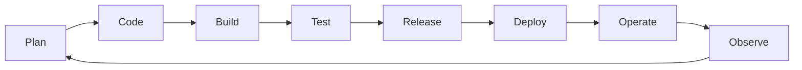

### 👋 Hi, I'm Nilesh

Exploring **DevOps, cloud, and automation**—with a focus on making software delivery more repeatable, observable, and reliable.

---

<table>
<tr>
<td width="55%" valign="top">

### 🧭 A little about me

- 🌱 Growing my skills in DevOps, cloud platforms, and Infrastructure as Code.
- 🛠️ Interested in the journey from source code to reliable services.
- 🔎 Exploring CI/CD, containers, monitoring, and cloud-native systems.
- 🤝 Open to learning projects and collaboration.

</td>
<td width="45%" valign="top">

### 🎯 My principles

> **Automate** the repeatable · **Observe** what you operate · **Improve** with every release

Small changes. Clear feedback. Reliable systems.

</td>
</tr>
</table>

## 🧰 DevOps toolkit

**CLOUD**

**CONTAINERS & ORCHESTRATION**

**INFRASTRUCTURE AS CODE**

**DELIVERY & AUTOMATION**

**SYSTEMS & SCRIPTING**

**OBSERVABILITY**

Tools I use or am exploring—I'm continuously learning and refining this toolkit.

## 🔄 The DevOps feedback loop

**Plan → Code → Build → Test → Release → Deploy → Operate → Observe → Improve**

- 🔁 **Automate** repeatable tasks and delivery steps.
- 🏗️ **Version** infrastructure changes alongside application code.
- 📈 **Observe** systems with useful logs, metrics, and alerts.
- 🔐 **Build in** secure defaults from development through deployment.

## 🚀 Projects & learning

I’m working toward practical projects in cloud, delivery automation, and infrastructure. Browse my repositories for the latest:

**Project ideas I enjoy:** CI/CD pipelines · containerized apps · reusable infrastructure · monitoring dashboards

> ⭐ Pin your best projects on your GitHub profile and give each repository a clear README with its purpose, setup, and architecture.

## 📊 GitHub dashboard

 

## 🤝 Connect

Have a project idea or a useful resource to share? Reach out through GitHub:

 

Thanks for visiting — keep learning, keep automating, and ship something great. ✨

